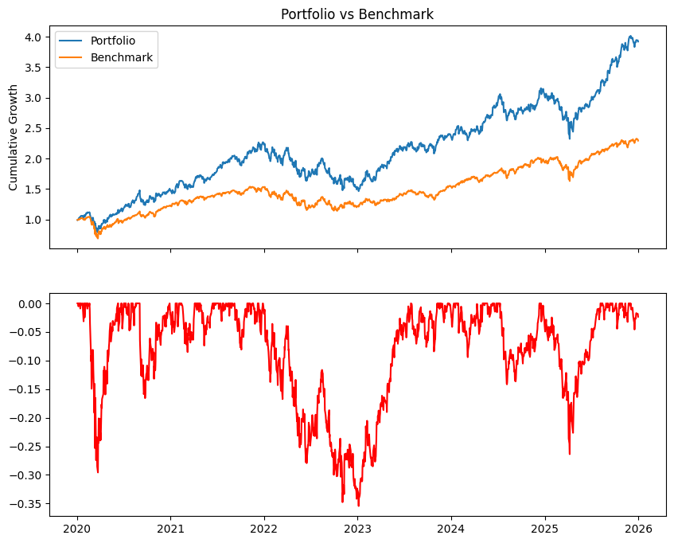
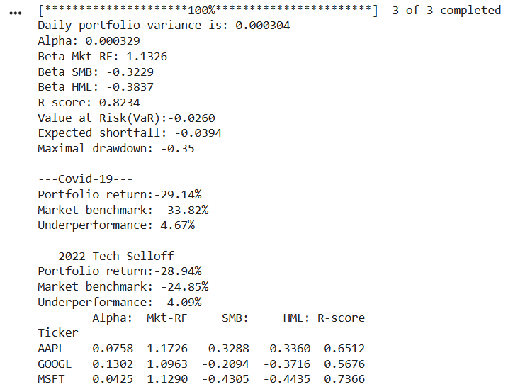

# Multi-Factor Portfolio Risk Attribution Engine
A quantitative portfolio risk and performance attribution engine built in Python. This project evaluates an equal-weighted equity portfolio against the Fama-French 3-Factor Model using OLS regression to isolate alpha and market beta. It features a historical stress-testing module and downside risk analytics (VaR, CVaR, and Maximum Drawdown) to assess portfolio resilience during major market crashes.
## Visual Output
 
## Asset Attribution & Downside Risk

## Methodology
$$ E(R_i) - R_f = \alpha + \beta_1(MKT - R_f) + \beta_2(SMB) + \beta_3(HML) $$
## Usage
1. Install dependencies: `pip install -r requirements.txt`
2. Run the notebook or script to view the attribution tables and charts.
